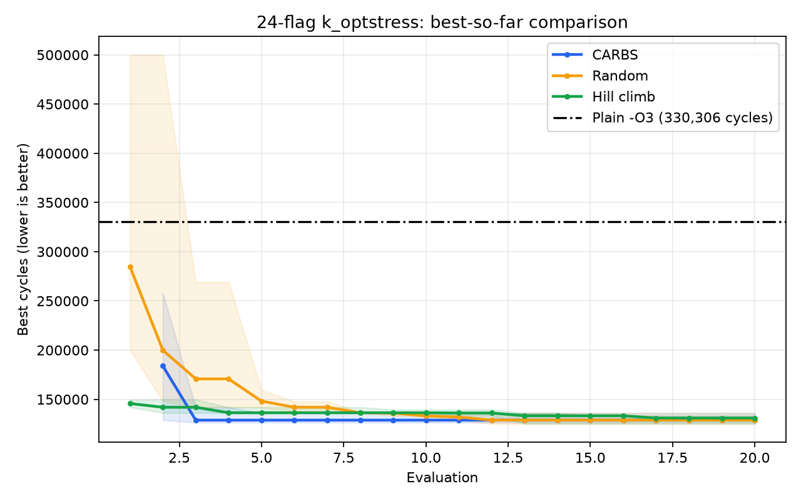
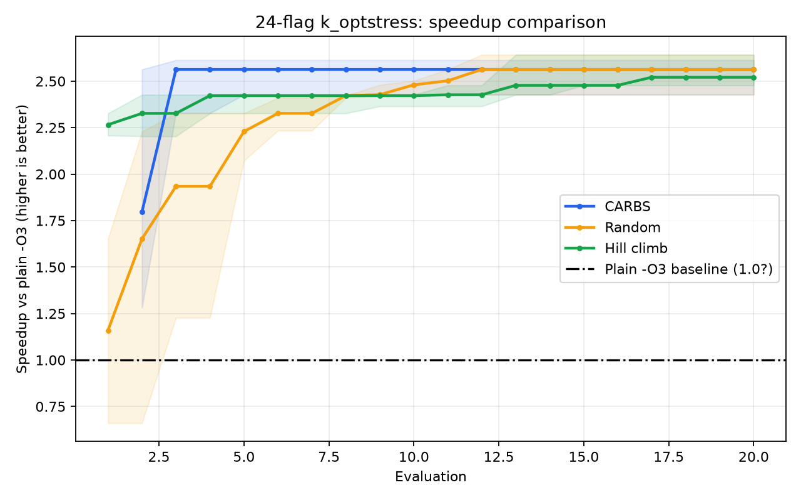

# ChampSim FlagBench workflow

This is a separate x86 trace-driven version of FlagBench. It does not reuse
gem5 outputs or the RISC-V binaries.

## Entangling prefetchers

The combined Entangling configuration runs the instruction and data
prefetchers together. The [Entangling guide](ENTANGLING_KNOBS.md) lists the
runtime controls, build command, and short comparison results.

## Datapath mapping

The ChampSim configuration in `champsim_config.json` approximates the current
FlagBench datapath:

- one out-of-order x86 core
- 4-wide fetch/decode/dispatch/execute/retire
- 128-entry ROB and 32-entry load/store queues
- 32 KiB, 8-way L1 instruction/data caches
- 256 KiB, 8-way L2 cache
- 1 MiB, 16-way LLC
- 2 GHz nominal frequency
- next-line L1 instruction prefetching and IP-stride L1 data prefetching
- no L2/LLC prefetching and LRU LLC replacement

ChampSim is trace-driven, so it models the pipeline and memory hierarchy after
the x86 binary has been traced. It does not execute the ELF directly like gem5.

## Windows setup for adaptive simulation

Use the adaptive workflow below for experiments and comparisons. `run_windows.py`
is a legacy full-space runner; it compiles every selected flag configuration
before tuning and is not recommended for real flag-space studies. To rebuild
ChampSim and PIN after changing `champsim_config.json`, run:

```powershell
python .\champsim\run_windows.py --build-only
```

The build regenerates ChampSim's module configuration before compiling. GNU
Make and LLVM Clang must be available on `PATH`; PIN is auto-detected under
Downloads or can be passed with `--pin`.

## Recommended workflow: adaptive simulation

`run_carbs_adaptive.py` is the recommended workflow. It preserves
`run_carbs.py` and `run_windows.py` as legacy exhaustive options, but asks the
selected tuner for one configuration at a time and compiles, traces, and
simulates only that configuration. The sampled measurements are cached, so a
repeated request does not create another binary or trace. Compiled reference
baselines are reused, and configurations with the same `.text` hash reuse the
recorded simulation. After each valid result is saved, the one-use binary,
trace, and verbose ChampSim stdout are deleted; small compiler/tracer logs,
baselines, and the measurement cache remain. Failure output is kept for
troubleshooting. This lets you explore larger spaces without first
materializing all `2^N` variants
or retaining a trace for every evaluation.

For example, use 20 flags and let CARBS request up to 100 evaluations:

```powershell
python .\champsim\run_carbs_adaptive.py `
  --repo . `
  --champsim-root .\champsim\source-windows `
  --pin C:\path\to\pin `
  --tracer .\champsim\source-windows\tracer\pin\obj-intel64\champsim_tracer.dll `
  --out .\champsim\results\adaptive-k-mix2 `
  --kernel k_mix2 `
  --nflags 20 `
  --budget 100 `
  --algorithm carbs
```

Use `--algorithm random` or `--algorithm hillclimb` to drive the same online
measurement loop with those selectors. The output includes `measurements.json`
(resume cache), the sparse `<kernel>.csv`, `carbs.json` (run history), and
`score_<kernel>.png` (best measured cycles by evaluation), and
`speedup_<kernel>.png` (speedup over plain `-O3`). Without `--compare`, the
graphs describe the selected algorithm only; use `--compare` for an online
CARBS, random-search, and hill-climb comparison. Adaptive sampling does not
claim exhaustive ground truth. Increase `--budget` to spend more compilation and simulation
time. The per-request backend currently starts the legacy runner, so a large
budget has some process-startup overhead. Set `--determinism 1` to rerun each
requested trace once and require identical cycle counts before accepting it.
Each adaptive configuration also has a 900-second simulator timeout by
default; timed-out configurations are recorded as invalid and the search
continues. Adjust this with `--simulation-timeout` if a valid long trace needs
more time. The legacy exhaustive runner leaves timeouts disabled unless that
option is passed directly. Windows skips the first 1,000 PIN instructions by
default, matching the Windows adaptive workflow. Every run measures plain
`-O3` as a separate baseline when it does not match a requested configuration.
It is not counted as a tuner evaluation. CARBS starts with uniform 0.5 flag
probabilities and chooses its first candidate from that prior. The O3 result
is cached by binary hash and shown as a reference line in adaptive
cycle graphs and as a 1.0x reference in a companion speedup graph. It is a
comparison value, not a flag configuration or a change to CARBS's probability
initialization: CARBS still starts every flag at probability 0.5. If the extra
baseline measurement fails, the rest of the run continues; baseline lines and
speedup graphs are omitted.

### Compare tuners without exhaustive enumeration

Add `--compare` to run CARBS, randomized search, and hill climbing online with
the same evaluation budget and seeds. All three share the measurement cache,
so a requested configuration is compiled and simulated only once. The runner
writes `score_compare_<kernel>.png` with median best cycle count and 95%
bootstrap bands, `speedup_compare_<kernel>.png` with best speedup over plain
`-O3` (the reference line is 1.0x), and `comparison.json` with per-seed traces,
speedup summaries, and the baseline cycle count. Lower cycle counts and
higher speedups are better. This compares search progress on
the sampled evaluations; it does not claim to know the global optimum of
unevaluated configurations.

The curated flag list supports `--nflags` through **24 flags** (16,777,216
possible configurations). Adaptive mode also accepts up to **64 custom flags**
through `--flags`; each must be supported by the selected compiler in both
enabled and disabled forms. The tuner and measurement cache scale with the
requested evaluation budget, not the exponential configuration count. The
current 64-flag custom limit is a practical interface limit, not an observed
algorithmic limit; 24 curated flags have compiler validation, while 64 was
validated with mock search requests. Use curated flags for a real run unless
you have checked every custom switch with the selected compiler.
Runtime depends on the requested evaluations, not on that total. For example,
a 24-flag comparison with 3 seeds and a budget of 20 makes at most 180 tuner
requests per kernel, before duplicate configurations and identical binaries
are reused:

```powershell
python .\champsim\run_carbs_adaptive.py `
  --repo . `
  --champsim-root .\champsim\source-windows `
  --pin C:\path\to\pin `
  --tracer .\champsim\source-windows\tracer\pin\obj-intel64\champsim_tracer.dll `
  --out .\champsim\results\compare-k-mix2-24flag `
  --kernel k_mix2 `
  --nflags 24 `
  --compare `
  --seeds 3 `
  --budget 20
```

A 2M-instruction evaluation took about one minute on the validation machine.
At that rate, the 180-request upper bound is roughly three hours per kernel;
actual time varies with hardware, kernels, and reuse. Reduce `--budget` to
shorten the comparison or increase `--seeds` for more stable confidence bands.
A bounded 200k-instruction validation completed in about 20 seconds including
compile and trace setup. Shorter traces reduce runtime and trace-generation
storage roughly in proportion to their instruction count, but may increase
sampling noise; 10k was too short to complete reliably in an earlier run.

### Kernels

| Kernel | Description | Expected flag sensitivity |
|---|---|---|
| `k_stencil` | 5-point Jacobi stencil | Moderate: vectorize + unroll |
| `k_ptrchase` | Pointer chase > L2 (control) | Very low: memory-latency bound |
| `k_branchy` | Bytecode interpreter | Low: data-dependent branches |
| `k_reduce` | Reduction + prefix sum | Moderate: unroll + vectorize |
| `k_crc32` | Bitwise CRC32 | Low-moderate: unroll + schedule |
| `k_helper` | Hot helper calls | Moderate: inline + IPA |
| `k_mix2` | 10-phase flag-stress kernel | **High**: stencil, reduce, CRC, helper, interchange, stride, FP matmul, IPA stress — opposing flag preferences produce the widest cycle range |
| `k_optstress` | Repeated independent floating-point array updates | **High for vectorization flags**: designed to expose loop and SLP vectorization differences |
| `k_hoist_iv` | Fixed-point 2D grid filter | Smooth sensitivity to loop-invariant motion, GCSE, IVOPTS, and predictive commoning |
| `k_slp_unroll` | Four-channel tuple updates plus an 8-tap FIR | Smooth sensitivity to SLP vectorization and loop unrolling |
| `k_epistasis_pipe` | Helper-heavy, multi-pass floating-point pipeline | High-order interactions among inlining, IPA-CP, loop splitting, unswitching, and vectorization |
| `k_multistage_gemm` | Tiled GEMM with an indirect histogram and transpose mix | High-order interactions among loop distribution, unrolling, and vectorization |

`k_optstress` isolates compiler-flag sensitivity in one hot loop and is the
recommended first check when validating whether vectorization settings change
performance. On the validation machine, adaptive ChampSim measured 14 of its
16 four-flag configurations with checksums correct; the sampled cycle counts
ranged from 138,259 to 331,507 (about 2.4x). Skip the initialization instructions
so the trace covers the hot loop. This is a small demonstration, not a stable
cross-machine performance claim:

```powershell
python .\champsim\run_carbs_adaptive.py `
  --repo . `
  --champsim-root .\champsim\source-windows `
  --pin C:\path\to\pin `
  --tracer .\champsim\source-windows\tracer\pin\obj-intel64\champsim_tracer.dll `
  --out .\champsim\results\compare-k-optstress `
  --kernel k_optstress `
  --nflags 4 `
  --compare `
  --seeds 3 `
  --budget 4 `
  --trace-instructions 500000 `
  --trace-skip-instructions 2000000 `
  --warmup-instructions 10000
```

The graph and per-configuration results are written to the output directory.
`k_mix2` is the recommended kernel for broader tuner discrimination: its FP matrix-multiply
phase benefits strongly from vectorization (4-8x with the right flags) while its CRC
phase prefers scalar code, and loop-interchange helps its column-major matrix phase
but can hurt the strided AXPY. No flag combination dominates every phase, so the
optimum is a real trade-off — exactly the kind of space CARBS is designed to search.
Correctness is guaranteed by a fixed-seed FNV-1a checksum verified against the
-O0 native reference for every configuration.

The default compiler backend is `wsl-mingw`. It uses Windows-targeting MinGW
GCC from WSL to produce PE executables, preserving the complete gem5/GCC flag
space while Windows Intel PIN can still trace the result:

```powershell
wsl.exe sudo apt-get update
wsl.exe sudo apt-get install -y mingw-w64
```

This does not use a WSL Linux executable or a WSL trace. The executable is
written into the Windows results directory and traced by native Windows PIN
and ChampSim. Group members can reproduce the compiler setup without a
machine-specific Windows compiler installation.

### Legacy exhaustive simulation (secondary option)

`run_windows.py` and `run_carbs.py` enumerate the selected flag space. At 24
flags, that means up to 16,777,216 configurations per kernel; each distinct
binary may also produce a large PIN trace. In local experiments, a couple of
full runs consumed about **730 GB**. Consumption depends on trace length and
binary deduplication, but exhaustive runs can require many hours and hundreds
of gigabytes. Use adaptive simulation for comparisons and larger spaces; the
exhaustive workflow is suitable only for small smoke tests or when a complete
truth table is specifically required. The adaptive workflow instead scales
with `--budget` and `--seeds`, caches only requested measurements, and removes
each one-use trace and binary after measuring it.

If you need to smoke-test the legacy runner, keep the space and trace tiny:

```powershell
python .\champsim\run_windows.py `
  --kernels k_stencil `
  --nflags 2 `
  --trace-instructions 1000 `
  --warmup-instructions 0 `
  --seeds 1 `
  --budgets 1 `
  --out .\champsim\results\legacy-smoke
```

Do not use this smoke test to compare tuners or report performance.

### Adaptive output

Each adaptive output directory contains a sparse `<kernel>.csv`, a
`measurements.json` resume cache, run history, and graphs. A comparison run
writes `comparison.json`, `score_compare_<kernel>.png` (best cycles by
requested evaluation), and `speedup_compare_<kernel>.png` (speedup against
measured plain `-O3`). The measurement cache and small compiler/tracer logs
are retained so a run can resume; successful simulator stdout, one-use
binaries, and traces are deleted after each result is saved. Existing cached
successful results also have their redundant simulator logs pruned when
resumed. Failure logs are kept for troubleshooting. Keep the requested output
directory if you want to resume or inspect per-configuration results.

### Windows prerequisites

- Python 3
- LLVM/Clang, including `clang.exe` and `llvm-objcopy.exe`
- GNU Make, only when using `--build`
- Intel PIN for Windows, with `pin.exe`
- ChampSim's vcpkg runtime DLLs under
  `champsim\source-windows\vcpkg_installed\x64-windows\bin`

The script automatically adds the standard LLVM installation directory and
finds the newest `pin-external-*-windows` directory under `Downloads`.

The Windows PIN tracer records the low 32 bits of each instruction pointer.
This keeps instruction identity stable for legacy ChampSim modules that use
Windows' 32-bit `long` ABI; data and memory addresses remain native 64-bit x86
addresses.

## Setup in WSL/Linux

Install Intel PIN 3.22 separately, then set `PIN_ROOT`. Build the ChampSim
tracer and simulator:

```bash
cd ~/ECE-752-linux
./champsim/setup.sh
cd champsim/.upstream/tracer/pin
make
```

Run an adaptive comparison in WSL/Linux (example paths assume the repo is
`~/ECE-752-linux`):

```bash
cd ~/ECE-752-linux
source .venv/bin/activate
python3 champsim/run_carbs_adaptive.py \
  --repo "$PWD" \
  --champsim-root "$PWD/champsim/.upstream" \
  --pin "$PIN_ROOT" \
  --tracer "$PWD/champsim/.upstream/tracer/pin/obj-intel64/champsim_tracer.so" \
  --out "$PWD/champsim/results/adaptive-k-mix2" \
  --kernel k_mix2 \
  --nflags 24 \
  --compare \
  --seeds 3 \
  --budget 20
```

Generated traces, binaries, logs, and results stay under the requested output
directory and should not be committed. Adaptive runs delete temporary binaries
and traces after recording each measurement.

## Adaptive compiler-flag simulation results

The adaptive simulator evaluates requested configurations instead of enumerating the full flag space. The completed `k_optstress` run covered 24 flags (16,777,216 possible configurations), with a budget of 20 evaluations per algorithm and three seeds. It recorded 174 requested configurations, of which 157 produced valid measurements. The plots show the median best-so-far cycle count and corresponding speedup against the saved plain `-O3` measurement (330,306 cycles); shaded areas show the reported 95% intervals across seeds.





At the final evaluation, the median best results were 128,861 cycles for CARBS (2.56x), 128,861 for random search (2.56x), and 130,998 for hill climb (2.52x). The plain `-O3` cycle count was measured and is plotted, but the run metadata marks its identity verification as false; treat the speedup comparison as provisional until that identity is verified. The run artifacts and per-seed measurements are in `results/compare-k-optstress-24flags/`.
